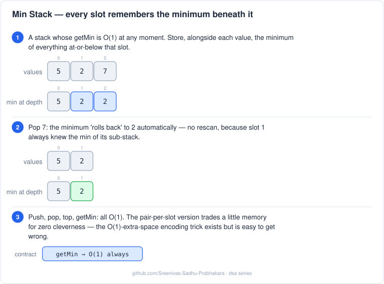

# Min Stack

> Striver SDE Sheet 087 · Day 14 Stack & Queue II — every entry carries the minimum-so-far beneath it, so Pop never has to recompute anything. Go, stdlib only, tested.

## Problem

A stack supporting Push, Pop, Top *and* Min — the current minimum — all in O(1). The trap: tracking one global minimum breaks the moment that minimum is popped, because the previous minimum is unknown.

## Approach

Store with each element the minimum of the stack *up to and including itself*: on push, `min(v, previous entry's min)`. The top entry's min field is then always the live answer, and popping automatically "restores" the older minimum because it was never lost — history is immutable below the top. This pairs-stack version spends one extra int per entry; the known refinements (second stack pushed only on new minima, or the encoded-difference trick for O(1) extra space) trade simplicity for memory and are worth mentioning in an interview, not worth the bugs here.

**Complexity:** all operations O(1); 2n ints of storage.

## Visual walkthrough

Read the picture top to bottom — each numbered frame is one moment of the algorithm
running on this repo's test example.

## Run

    go test ./...   # verify
    go run .        # demo

---

One of 191 repos solving Striver's SDE Sheet in Go — stdlib only, one problem per repo, every solution tested. Browse the set: [`dsa-*` repos](https://github.com/Sreenivas-Sadhu-Prabhakara?tab=repositories&q=dsa-&type=source).
